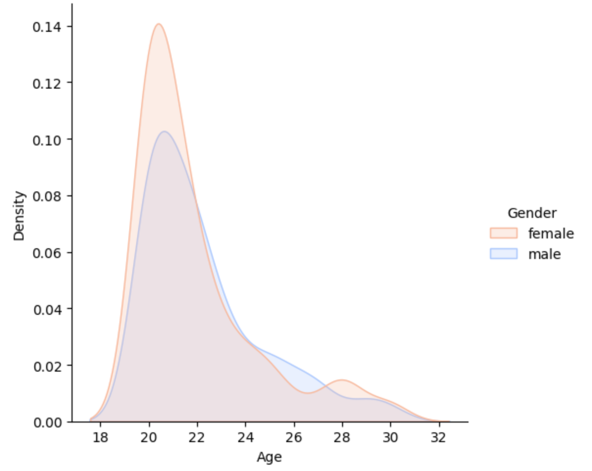
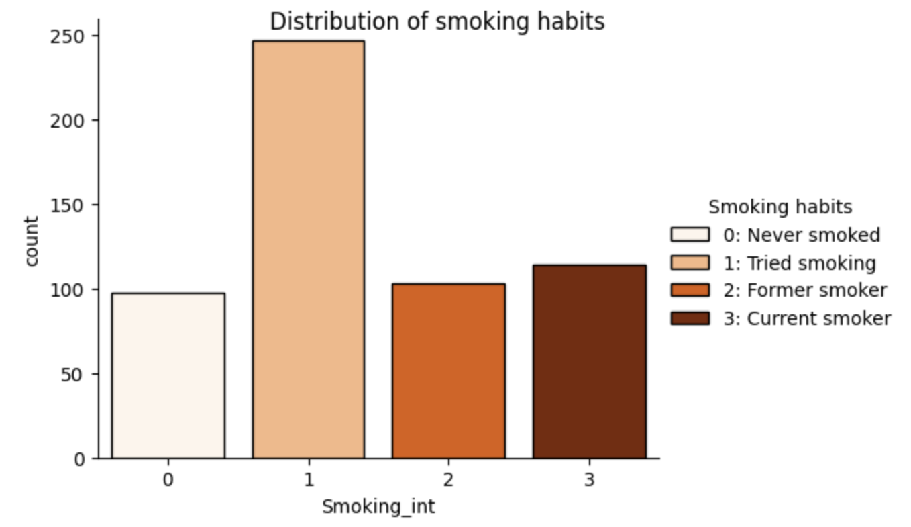

# Исследовательский анализ данных и предсказание расходов на здоровое питание (YPS Dataset)

## 📊 О проекте

Данный проект посвящен исследованию потребительского поведения на основе опроса о здоровом образе жизни (YPS Dataset). В работе проведен полный цикл разведочного анализа данных (EDA), от очистки и визуализации до проверки гипотез. Основная цель — выявить, как самооценка здоровых привычек коррелирует с реальной готовностью потребителей платить больше за качественные продукты. В качестве экспериментальной части построены и сравнены модели классификации для прогнозирования уровня расходов на здоровое питание.

**Основной исследовательский вопрос:** 
*Как самооценка человека, считающего, что он ведет «очень здоровый образ жизни», коррелирует с его финансовыми привычками, в частности, с готовностью "с радостью платить больше денег за хорошие, качественные или полезные продукты питания"?*

Проект демонстрирует полный цикл работы с данными: от очистки и визуализации до построения и сравнения моделей классификации.

## 🛠 Стек технологий

*   **Язык:** Python 3.10+
*   **Анализ данных и визуализация:** Pandas, NumPy, Seaborn, Matplotlib, SciPy
*   **Машинное обучение:** Scikit-learn (RandomForestClassifier, LogisticRegression, MLPClassifier)
*   **Среда разработки:** Jupyter Notebook

## 📂 Структура проекта

*   `YPS.csv` — исходный датасет.
*   `research_project.ipynb` — основной Jupyter Notebook со всем кодом (предобработка, EDA, визуализация, ML).
*   `README.md` — описание проекта.

## 🚀 Ключевые этапы работы

### 1. Предобработка данных и Feature Engineering
*   Выделено подмножество релевантных признаков для анализа (`Smoking`, `Alcohol`, `Healthy eating`, `Finances`, `Spending on healthy eating`, `Age` и др.).
*   Удалены строки с пропущенными значениями (`dropna`).
*   Отфильтрованы респонденты младше 20 лет, так как они, вероятно, не имеют регулярного дохода, и их финансовые привычки менее показательны.
*   Категориальные переменные (курение, алкоголь, пол) переведены в числовой формат для использования в моделях.

### 2. Разведочный анализ данных (EDA)
*   Построены гистограммы распределения возраста и пола.
*   Проанализировано распределение вредных привычек (курение, алкоголь) в зависимости от пола.
*   **Ключевое наблюдение:** Большинство респондентов оценивают свое питание как среднее (3-4 по шкале). При этом намерение тратить больше на здоровую еду (оценки 4-5) встречается чаще, чем реальное следование здоровым привычкам. Это может указывать на склонность респондентов приукрашивать свои привычки.

**Визуализации:**

> **Вывод**: Распределение возраста смещено в сторону молодой аудитории (пик приходится на 19–21 год). При этом женщин в выборке больше, и их пик чуть более выражен. Это объясняет, почему при фильтрации по возрасту (до 20 лет) выборка значительно сокращается.

> **Вывод**: Большинство респондентов (около 45%) находятся в категории «1: Пробовали курить». При этом действующих курильщиков (категория 3) меньше, чем тех, кто бросил (категория 2). Это говорит о том, что выборка смещена в сторону людей, которые имели опыт с табаком, но не являются заядлыми курильщиками. Эти данные могут быть использованы для дальнейшей сегментации при анализе здорового образа жизни.

### 3. Построение моделей машинного обучения
Задача была сформулирована как **классификация** (предсказание оценки от 1 до 5 для переменной `Spending on healthy eating`).

Были протестированы три модели:
1.  **Random Forest Classifier** (с параметром `class_weight='balanced'` для борьбы с дисбалансом классов).
2.  **Logistic Regression**.
3.  **MLP Classifier (Нейронная сеть)**.

**Результаты:** 
Все модели показали близкие результаты (`Accuracy ~ 33%`). Это ожидаемо, так как корреляция между признаками слабая (максимальная корреляция у признака `Healthy eating` — 0.302), а классы сильно несбалансированы (например, класса 1 всего 23 записи, а класса 4 — 184).

## 💡 Ключевые бизнес-выводы

1. **Нет прямой линейной связи:** Финансовые привычки человека сложно предсказать только на основе его отношения к здоровому образу жизни. Люди могут хотеть покупать полезную еду, но не делать этого по финансовым причинам.
2. **Слабая предсказательная способность:** Для точного прогнозирования расходов на здоровое питание одних демографических данных и самооценки недостаточно. Бизнесу (например, сервисам доставки еды) стоит собирать данные о реальных транзакциях, а не полагаться на опросы.
3. **Сложность проблемы:** Результаты показывают, что для решения этой задачи требуются более сложные подходы, возможно, с использованием NLP (анализ текстов) или данных о реальных покупках, а не синтетических опросников.

## ⚙️ Как запустить проект

1. **В браузере (самый быстрый способ):**
   Используйте Google Colab:
   [Google Colab](https://colab.research.google.com/drive/1qdKnLfIAyOUli26Uwqg28O9KGuOnztFR?usp=sharing)

2. **Локально:**
   Склонируйте репозиторий (`git clone https://github.com/yanesskka/YPS.git`) и откройте `research_project.ipynb` в Jupyter Notebook.
